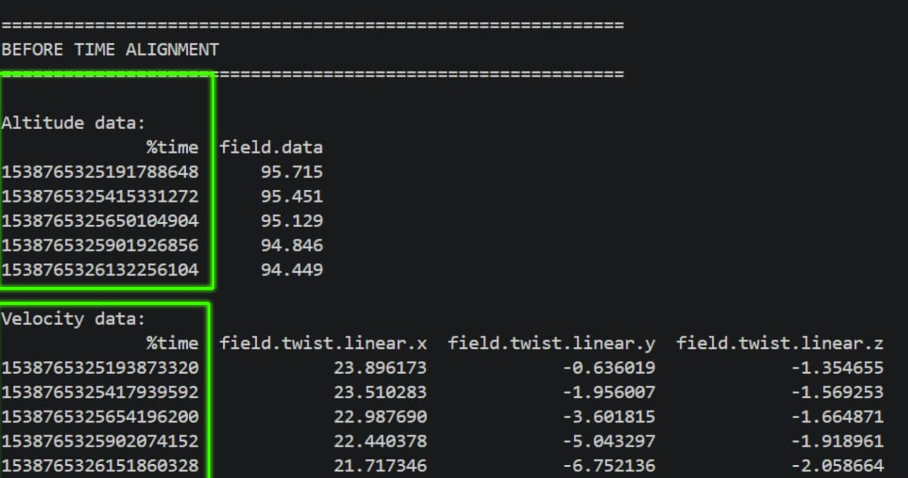
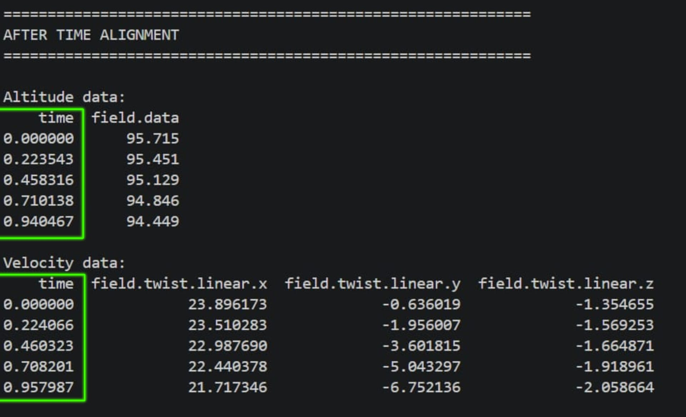
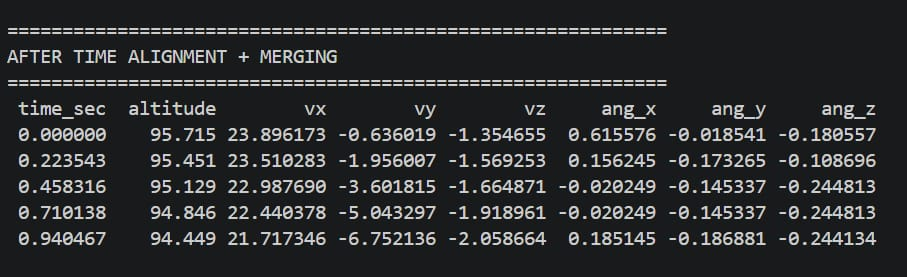
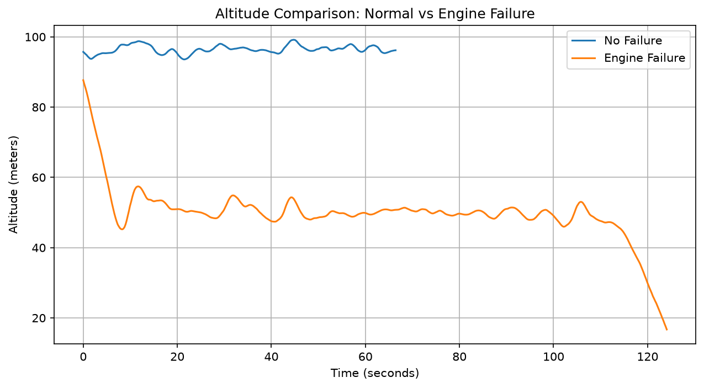
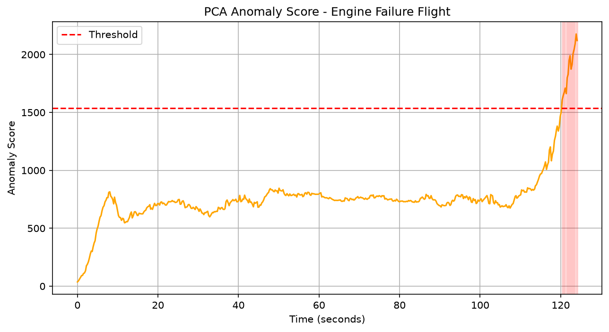

# UAV Flight Anomaly Detection Using PCA

## Objective
In this project, I analyzed real fixed-wing drone flight sensor data to detect in-flight failures automatically, without being told in advance when or if a failure occurred. The pipeline consists of several stages:

- Extracted and cleaned real UAV telemetry data (altitude, velocity) from the ALFA dataset.
- Aligned multiple independently logged sensor streams into a single time-synced dataset using Python.
- Modeled normal flight behavior using PCA (Principal Component Analysis), and used it to score how abnormal each moment of a failure flight was.
- Validated the model's detected failure point against the dataset's official ground-truth failure timestamp.

As this project is focused on analysis and detection methodology, the emphasis is on sensor alignment, anomaly scoring, and validating results against ground truth.

The sections below explain the dataset, tools, process, and results in more detail.

## Table of Contents

- [Dataset Used](#dataset-used)
- [Technologies](#technologies)
- [Process](#process)
  - [Step 1: Data Cleaning and Alignment](#step-1-data-cleaning-and-alignment)
  - [Step 2: Modeling Normal Flight Behavior](#step-2-modeling-normal-flight-behavior)
  - [Step 3: Anomaly Detection](#step-3-anomaly-detection)
  - [Step 4: Validation Against Ground Truth](#step-4-validation-against-ground-truth)
- [Results](#results)
- [Limitations](#limitations)
- [What I'd Improve With More Time](#what-id-improve-with-more-time)
- [Running It](#running-it)
- [Repository Structure](#repository-structure)

## Dataset Used
This project uses the ALFA (Air Lab Failure and Anomaly) Dataset, built by Carnegie Mellon University's AirLab and published at ICRA 2019 / IJRR 2021. It contains real recorded flights of a fixed-wing UAV, including flights with intentionally induced failures (engine loss, control surface faults) and normal flights for comparison, along with official ground-truth timestamps for when each failure occurred.

More info about the dataset can be found here:

- Website: https://theairlab.org/alfa-dataset/
- GitHub (tools + docs): https://github.com/castacks/alfa-dataset

Flights used:

- Normal (training): `carbonZ_2018-10-05-14-34-20_1_no_failure`
- Failure (testing): `carbonZ_2018-09-11-11-56-30_engine_failure`

Signals used from the dataset:

- `mavros/global_position/rel_alt` - relative altitude (m)
- `mavros/local_position/velocity` - linear and angular velocity
- `failure_status/engines` - ground-truth engine failure status, used for validation only

## Technologies
The following tools were used to build this project:

- Language: Python
- Data cleaning & alignment: pandas, numpy
- Modeling: scikit-learn (StandardScaler, PCA)
- Visualization: matplotlib

## Process

### Step 1: Data Cleaning and Alignment
Each sensor logs independently and at a different rate, using raw Unix nanosecond timestamps. I converted timestamps to seconds relative to flight start, then merged the altitude and velocity readings using nearest-timestamp matching (`pandas.merge_asof`, 2.5 s tolerance) into a single aligned table per flight. This was necessary since the two sensors don't record at the exact same moments.

*data before cleaning*
<p align="center">
  
</p>

*data after cleaning*
<p align="center">
  
</p>

*Aligned altitude and velocity sensor data*
<p align="center">
  
</p>

### Step 2: Modeling Normal Flight Behavior
Using only a flight with no failure, I standardized 7 signals (altitude, 3-axis velocity, 3-axis angular velocity) and fit a PCA model on them, keeping enough components to explain 95% of the variance. This teaches the model the normal relationship between these signals during healthy flight, rather than a fixed "safe range" for any single sensor.

*Altitude comparison between normal and failure flight*
<p align="center">
  
</p>

### Step 3: Anomaly Detection
For the failure flight, I scaled each moment's signals with the normal-flight scaler, projected them into PCA space and reconstructed them back. The reconstruction error at each timestamp becomes an anomaly score. The larger the error, the more that moment's behavior deviates from what PCA learned as normal. A detection threshold (mean + 1 standard deviation of the scores) flags the point where the score first becomes abnormal.

*PCA anomaly score over flight duration*
<p align="center">
  
</p>

### Step 4: Validation Against Ground Truth
The dataset includes an official record of the exact moment the engine failure was triggered. I compared this ground-truth timestamp against my model's detected anomaly point to check the result rather than relying on visual guesswork.

*PCA detection compared with ground truth failure timestamp*
<p align="center">
  
</p>

## Results
- The engine failure happened at **103.4 s** according to the ground truth. The anomaly score first crossed the threshold at **115.9 s**, so the detection came **12.5 s** after onset.
- The flight's altitude dropped twice: once early on (~8 s in), and again later (~110 s in, ending in a crash).
- It would be easy to assume the early drop was the failure because it is the more visually dramatic point in the raw altitude data. Ground truth shows the failure was much later, so the early drop was unrelated. My read is that it's the takeoff settling into stable flight, and since the normal flight goes through the same phase, the model treats it as normal. I haven't checked this against the flight-mode logs.
- The PCA anomaly score stayed below the threshold during the early drop and only crossed it after the real failure.
- In this flight, the method flagged genuine abnormal behavior rather than just any altitude change, which a simple threshold on one sensor would not have separated.

One thing to keep in mind is that altitude is one of the 7 input signals, so part of what gets flagged at 115.9 s may be the descent after the failure rather than the engine loss itself.

## Limitations
- This is one failure flight compared against one normal flight, so it shows the method works on this case, not that it generalizes.

## What I'd Improve With More Time
- Incorporate additional signal channels (roll, pitch, yaw, actuator outputs) to improve detection for fault types that affect orientation more than altitude.
- Test the same method against the dataset's other fault types (aileron, rudder, elevator failures) to check how well it generalizes.
- Formally evaluate false positive / true positive rates across multiple flights rather than a single validated case.

## Running It
1. Download the processed ALFA flights listed above from the dataset page.
2. `pip install pandas numpy scikit-learn matplotlib`
3. Update the four file paths in the `__main__` block of `my_file.py` to your local copies.
4. Run `python my_file.py`. The plot is saved to `figures/altitude_comparison.png`, so the `figures/` folder needs to exist.

## Repository Structure
```
├── my_file.py      # main analysis script
├── figures/        # exported graphs
└── README.md       # this file
```
